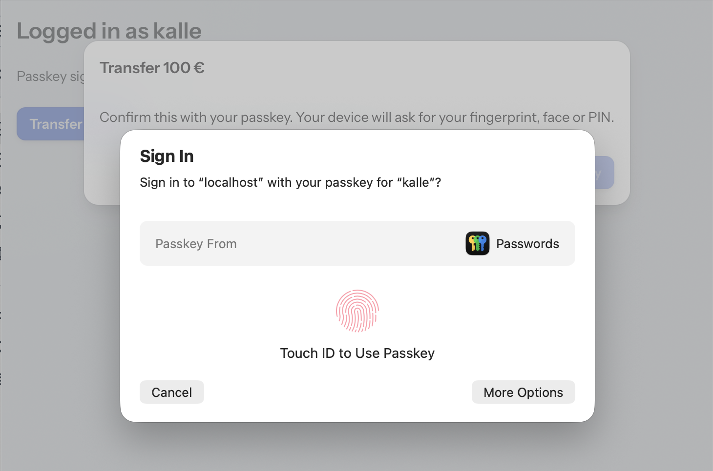

# Passkey re-authentication for Vaadin

Ask the logged-in user to confirm a sensitive action with a passkey, a.k.a. "step-up authentication" or "sudo mode". User verification is required, so on today's devices this means a fingerprint, face or the device PIN, proving that the same person is still at the keyboard (and not a colleague who found the laptop unlocked). A typical need e.g. in banking apps.



*The add-on tells what is being confirmed ("Transfer 100 €"), and the operating system asks for the passkey (here Touch ID in Safari on macOS).*

```java
reauthentication.runAfterVerification("Transfer 100 € to Bob",
        () -> bankService.transfer(amount),
        e -> Notification.show("Not confirmed: " + e.getMessage()));
```

The browser/OS passkey prompt can't be customized, and it typically talks about "signing in". So this first opens a `ReauthenticationDialog` that tells the user what they are about to confirm. The dialog is placed near the top of the page, so it stays visible while the passkey prompt is open in the middle.

If your own UI already explains the action, `runAfterVerification(action, onFailure)` asks for the passkey right away. `verify()` does the same and returns a `CompletableFuture`.

The whole WebAuthn ceremony happens over Vaadin's own communication:

- The challenge is kept in server memory.
- The browser part is a single `executeJs` call, with `userVerification: "required"`. Only the passkeys of the current user are allowed (`allowCredentials`).
- The response is verified with [WebAuthn4J](https://github.com/webauthn4j/webauthn4j) against the stored public key.

No HTTP endpoints, cookies or changes to the login session are involved. So it works the same with any security framework, as long as you can list the passkeys of the current user.

## Localization

The texts of the dialog and the error messages (`ReauthenticationException.getMessage()`) have English defaults.

- **Localize or override them for the whole app:** add the keys to your Vaadin translations, e.g. `src/main/resources/vaadin-i18n/translations_fi.properties`. The keys are listed in `ReauthenticationTexts`.

  ```properties
  passkey-reauthentication.dialog.hint=Vahvista passkeylläsi. Laitteesi kysyy sormenjälkeä, kasvoja tai PIN-koodia.
  passkey-reauthentication.dialog.confirm=Vahvista passkeyllä
  passkey-reauthentication.dialog.cancel=Peruuta
  passkey-reauthentication.error.no-passkeys=Sinulla ei ole passkeytä, jolla vahvistaa toiminto
  ```

- **Change the texts of a single dialog:** create the dialog yourself.

  ```java
  var dialog = new ReauthenticationDialog(reauthentication, "Transfer 100 € to Bob", action, onFailure);
  dialog.getConfirmButton().setText("Approve transfer");
  dialog.open();
  ```

## Usage

Implement `PasskeyStore` on top of your passkey storage and create one `PasskeyReauthentication`, e.g. as a bean. Use the same relying party id and origins as your login:

```java
new PasskeyReauthentication(new PasskeyStore() {
    public List<StoredPasskey> passkeysOfCurrentUser() {
        return repository.findByUser(currentUser()).stream()
                // Spring Security stores COSE keys; for X.509 keys (Quarkus) use StoredPasskey.fromX509(...)
                .map(p -> new StoredPasskey(p.credentialId, p.publicKey, p.signatureCount))
                .toList();
    }

    public void signatureCountUpdated(StoredPasskey passkey, long newSignatureCount) {
        // store the counter, like your login does
    }
})
        .withRelyingPartyId("example.com")
        .withAllowedOrigins("https://example.com");
```

Complete examples with browser tests are in [PathToPasskeys](https://github.com/mstahv/pathtopasskeys):

- Spring Boot + Spring Security, in the `main` branch: `ReauthenticationConfiguration` and `SensitiveActionView`.
- Quarkus, in the `quarkus` branch: `ReauthenticationPasskeys` and `SensitiveActionView`.

## Development

`src/test` contains a small demo app (`TestServer`, a Spring Boot app used only for development and testing):

1. Sign up with a passkey in `RegistrationView`, or log in with one registered earlier (users live in memory, so only until a restart). The registration and login are done directly with WebAuthn4J, and "logging in" just stores the username in the Vaadin session. There is no security framework at all.
2. Then use the library in `SensitiveActionView`.

Run `TestServer`'s main method and open http://localhost:9998.

The browser tests (`src/test/java/in/virit/passkeyreauth/it`) run against the same app with [Playwright](https://playwright.dev/java/) and [DramaFinder](https://github.com/parttio/dramafinder), using Chromium's virtual authenticator in place of a real one. They cover:

- the happy path, including the signature counter update
- a failed user verification
- a user without passkeys
- a passkey of another user
- a response from a wrong origin

```
mvn verify                                          # add -Dheadless=false to watch
mvn verify -Dwebauthn4j.version=0.31.10.RELEASE     # with the newer WebAuthn4J
```

## Releasing

The parent (`in.virit.sb:viritin-addon-project-parent`) has a `release` profile with sources, javadocs, GPG signing and the Sonatype Central publishing plugin (server id `central` in `settings.xml`):

```
mvn release:prepare release:perform
```

## Compatibility

- Vaadin 25.
- WebAuthn4J 0.30 and 0.31 (the version used by your security framework wins).
- Tested with Spring Security 7.1 and Quarkus 3.40.
